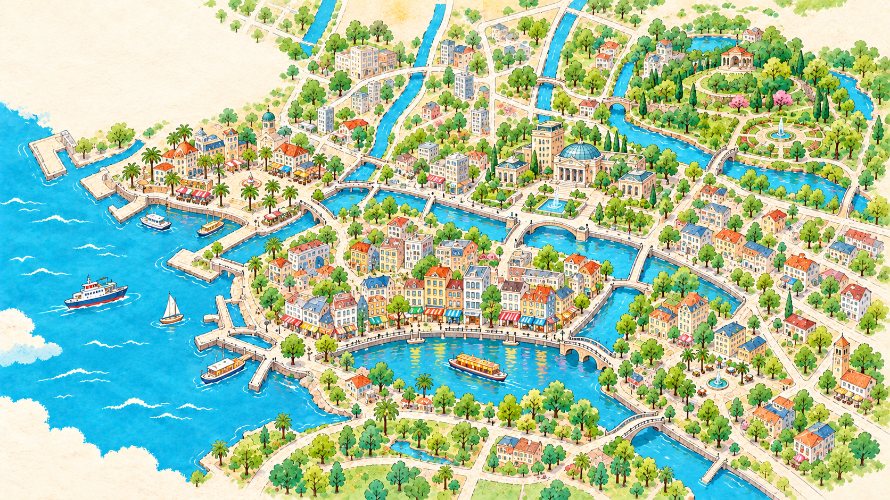

# Route Story Studio

把零散的照片、视频和文字，组织成以地图探索为主线的故事影片。

Travel between regions is the outer spine; thematic stories inside each place are the inner spine. The skill handles structure, curation and editorial decisions. Portable scripts handle media inventory, contact sheets, avatar travel, photo/video cards, captions, music and MP4 rendering.

## Default visual standard

When the user leaves style, layout or typography unset, inherit the shipped design rather than producing a low-fidelity map diagram.



- Watercolor regional artwork and warm paper, adapted to the user's places.
- Anonymous anime portrait marker, coral paths and clear place labels.
- Connected photo filmstrip, large photo/video cards and consistent type.
- Editable story structure, paced notes and uncluttered farewell.

## Two modes

- **One-shot / 一次性交付**: give your available files, goal and preferences; receive an actual film plus an editable project. Missing optional material is handled through explicit production choices, not fabricated personal facts.
- **Interactive / 交互制作**: supply material and discuss important choices. When you say you have nothing more to add and ask to produce, intake closes and rendering proceeds.

## Use in Codex

Ask the skill installer to install `skills/route-story` from your clone or repository, or place that folder in a supported local skill discovery location. Invoke `$route-story` with your input directory and desired result. The repository itself does not automatically star/fork anything or upload your material.

Example request:

> Use $route-story. Here are my trip photos, videos and notes. Make a 90-second map-led story film, with theme-based sections inside each region. Work one-shot and finish with the material available.

## Use in ChatGPT

The root `plugin.json` bundles the skill under the portable Agent Plugins format. A local marketplace entry is included for supported local hosts. Distribution to ChatGPT on the web requires that host's supported plugin installation/public-directory mechanism; this repository alone does not provision code execution, local disk access or a video-rendering service. Check runtime capabilities before promising an MP4.

Official packaging reference: https://developers.openai.com/plugins/build/plugins

## Local renderer smoke test

Requirements: Python3.9+, FFmpeg/FFprobe on PATH, Pillow and NumPy. A consistent OFL WenKai font is bundled for CJK/Latin text. Optional HEIC support: pillow-heif or an available native decoder.

```bash
python -m pip install -r requirements.txt
python skills/route-story/scripts/route_story.py doctor
python skills/route-story/scripts/make_demo.py --out runs/demo
python skills/route-story/scripts/route_story.py keyframes runs/demo/story.json --ledger runs/demo/ledger.json --out runs/demo/keyframes
python skills/route-story/scripts/route_story.py render runs/demo/story.json --ledger runs/demo/ledger.json --out runs/demo/output
python -m unittest discover -s tests -v
```

The demo is wholly fictional, drawn by code, and includes an original simple review music bed. It is not a real user's journey. No personal photos, real-person avatar or music recordings are bundled. Anonymous generated atlas art and an OFL WenKai font are included.

## What is shared

The reusable skill, scripts, references and synthetic example generator. Your input material, account state, local paths, media library, output film and private testing evidence stay outside this package. Publishing or uploading them requires your separate instruction.

## Scope of v0.2

A usable landscape renderer with map/move/photo/video/note/title scenes, source tracing, trim bounds, privacy-box redactions, keyframe previews, timed music mixing and editable JSON. The default is a complete illustrated watercolor atlas system: shipped production backdrops, anonymous anime portrait, paper filmstrip, typography, coral routes, large shadowed media cards and notebook/closing layouts. Missing preferences inherit this design. A host may adapt regional backgrounds while text/routes/avatars remain editable. Primitive diagrams are not the default production output. Other aspect ratios, automatic face detection and cloud video rendering are not claimed.

## Project support

If the project helps you, consider starring it. Fork it when you want to customize or contribute. Neither is a usage prerequisite, and the agent must not perform either action without your request.

## Release status

v0.2.0 is an initial release candidate. Its illustrated map → avatar travel → photo-card design has passed a representative visual review. The two intake modes have been exercised in isolated fresh-context workflows. This is not a claim of full aesthetic acceptance for every scene combination, cross-platform certification or a tested ChatGPT-web rendering service. Crowded thematic layouts may still require editorial adjustment.

This private staging repository is prepared for review. Public visibility and the project license are pending owner approval. No private test input or generated user film is included.

Third-party font: LXGW WenKai, OFL-1.1, included unmodified with its notice. Referenced music retains its own rights; no recording is included. The music catalogue is reference-only and performs no automated audio collection.
